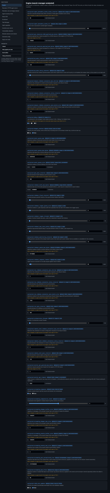
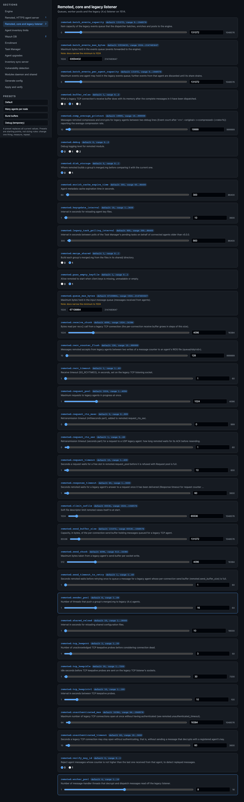
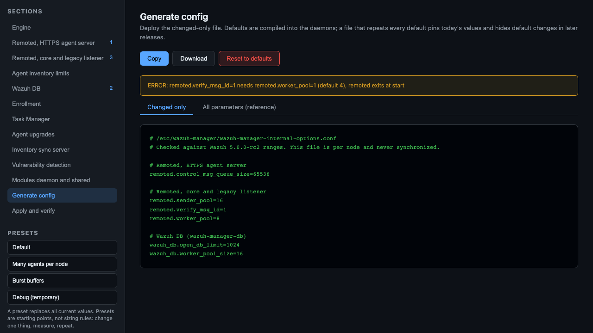
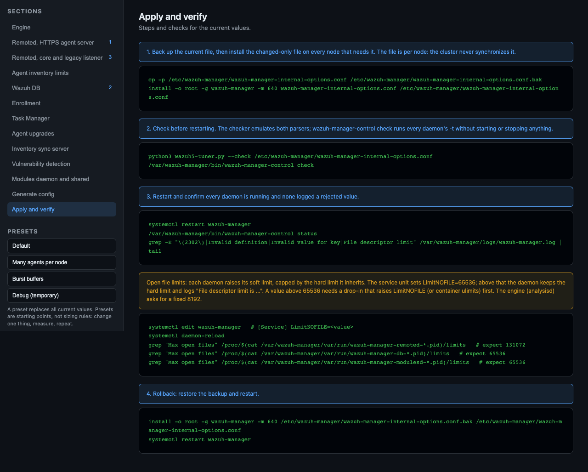

# wazuh5-tuner


Local web UI and checker for the Wazuh 5 manager file
`/etc/wazuh-manager/wazuh-manager-internal-options.conf`.
It offers 255 manager options with the defaults and ranges taken from the
[v5.0.0-rc2 source](https://github.com/wazuh/wazuh/tree/v5.0.0-rc2), cross-checked against the
rc2 documentation, blocks values the daemons reject, and shows the commands to apply and check
the result.

One file, Python standard library only, no install step.

For Wazuh 4.x (`/var/ossec/etc/local_internal_options.conf`) use
[wazuh-tuner](https://github.com/adampielak/wazuh-tuner).

## What changed from 4.x

| | 4.x | 5.0.0-rc2 |
|---|---|---|
| File | `/var/ossec/etc/local_internal_options.conf` | `/etc/wazuh-manager/wazuh-manager-internal-options.conf` |
| Defaults | listed in `internal_options.conf`, replaced on upgrade | compiled into the daemons; the manager reads only this one file, shipped with comments only (`src/shared/include/defs.h:279`) |
| Owner | `root:wazuh 0640` | `root:wazuh-manager 0640` |
| Binaries | `/var/ossec/bin` | `/var/wazuh-manager/bin` |
| Log | `/var/ossec/logs/ossec.log` | `/var/wazuh-manager/logs/wazuh-manager.log` |

## Two parsers read the same file

| | C daemons (remoted, wazuh-db, authd, modulesd) | Engine (`analysisd.*` keys) |
|---|---|---|
| Code | `src/shared/src/validate_op.c` | `src/engine/source/conf/src/fileLoader.cpp` |
| Duplicate key | first line wins | last line wins |
| Line starting with space | skipped | trimmed and read |
| Line starting with tab | read, but the section becomes `\tremoted` and never matches | trimmed and read |
| Inline `# comment` | part of the value: fatal | ends the value |
| Trailing space | part of the value: fatal | trimmed |
| Quotes | part of the value: fatal | stripped |
| Value | optional `-`, digits, within `int` and the option range | `true`/`false` or an integer that fits the C++ type and range |
| Bad value | `(2302): Invalid definition for <s>.<o>: '<v>'.` and the daemon exits | `Invalid value for key '<k>' from the internal options file: ...` and the engine exits |
| Unknown key | ignored | ignored |

`--check` emulates both parsers line by line.

## Quick start

```bash
git clone https://github.com/adampielak/wazuh5-tuner.git
cd wazuh5-tuner
python3 wazuh5-tuner.py
```

Open `http://127.0.0.1:7438`. The UI has no authentication and binds to localhost by default.
Use `--host 0.0.0.0` only on a trusted network, and `--port` to change the port.

## What it does

- One page per component: engine, remoted (HTTPS agent server and legacy listener), agent
  inventory limits, wazuh-db, authd, Task Manager, agent upgrades, inventory sync server,
  vulnerability detection, modules daemon.
- Inputs are clamped to the source range. Options whose default the module computes at start
  (for example `wazuh_modules.manager_task_executor_threads`) stay unset when left blank.
- Rules that combine options are checked live, in the UI, in `POST /api/generate` and in
  `--check` (see [Rules across options](#rules-across-options)).
- **Generate config** gives the changed-only file. Copy and Download use it. The full listing is
  for reference only: a file that repeats every default pins today's values and hides default
  changes in later releases.
- **Apply and verify** lists the install, check, restart and rollback commands for the values
  you changed (open file limits, thread stack size, debug).
- `--check FILE` reads a deployed file the way both parsers do and exits 1 on any value that
  stops a daemon:

```
$ cat -A wazuh-manager-internal-options.conf
remoted.worker_pool=4 $
^Iremoted.sender_pool=16$
remoted.verify_msg_id=1$
analysisd.debug=1$
analysisd.debug=2$
analysisd.dumper_enabled=yes$
$ python3 wazuh5-tuner.py --check wazuh-manager-internal-options.conf
ERROR  line 1: remoted.worker_pool: '4 ' is not a plain integer (inline comment or trailing space?), the daemon exits (2302)
WARN   line 2: remoted.sender_pool: line starts with whitespace, C daemons ignore it
ERROR  line 3: remoted.verify_msg_id=1 needs remoted.worker_pool=1 (default 4), remoted exits at start
WARN   line 4: analysisd.debug: overridden by line 5 (engine: last line wins)
ERROR  line 6: analysisd.dumper_enabled: 'yes' is not true or false, the engine exits at start
wazuh-manager-internal-options.conf: 3 error(s), 2 other finding(s)
```

- API: `GET /api/params`, `GET /api/presets`, `POST /api/generate` with
  `{"values": {"remoted.worker_pool": 8}}` (returns the file, or HTTP 400 with the rejected
  values), `POST /api/check` with the file as the body.

## Rules across options

| Rule | Level | Source |
|------|-------|--------|
| `remoted.verify_msg_id=1` needs `remoted.worker_pool=1`. The default pool is 4, so setting only `verify_msg_id=1` stops remoted. | error | `src/remoted/src/main.c:162` |
| `wazuh_modules.manager_task_delete_timeout` must be greater than `manager_task_vd_scan_timeout`. | error | `src/config/src/wmodules-task-manager.c:177` |
| Both `inventory_sync_server_indexer_sync_max_retry_attempts` and `..._max_retry_duration_seconds` at 0. | warning | `src/wazuh_modules/src/wm_inventory_sync_server.c:370` |
| `remoted.control_keepalive_throttle` at or above half of `<agents_disconnection_time>` (900 s by default, set in `wazuh-manager.conf`). | warning | `src/remoted/src/secure.c:721` |
| `remoted.auth_max_body_size` not below `remote.https.max_body_size` when `wazuh-manager.conf` sets it. | warning | `src/remoted/src/secure.c:573` |

The last two compare with `wazuh-manager.conf` values the tuner cannot see, so the tuner warns
from the default `agents_disconnection_time` and from 10 MiB.

## Presets

A preset replaces all current values. Treat it as a starting point: change one thing, measure,
adjust.

| Preset | Changes | Use when |
|--------|---------|----------|
| Default | none | Reset |
| Many agents per node | remoted workers 8, senders 16, control queue 65536, wazuh-db workers 16, open DBs 1024 | thousands of agents on one node |
| Burst buffers | engine event queue 262144 slots and 64 MiB, remoted input queue 128 MiB | drops during restarts or scan bursts |
| Debug (temporary) | `debug=1` on every daemon that has a debug key | short troubleshooting window |

## Deploy

```bash
T=/etc/wazuh-manager/wazuh-manager-internal-options.conf
cp -p $T $T.bak
install -o root -g wazuh-manager -m 640 wazuh-manager-internal-options.conf $T
python3 wazuh5-tuner.py --check $T
/var/wazuh-manager/bin/wazuh-manager-control check
systemctl restart wazuh-manager
/var/wazuh-manager/bin/wazuh-manager-control status
grep -E "\(2302\)|Invalid definition|Invalid value for key|File descriptor limit" /var/wazuh-manager/logs/wazuh-manager.log | tail
```

Rollback: install `$T.bak` back and restart `wazuh-manager`.

Notes:

- The file is per node. The cluster does not synchronize it.
- `wazuh.thread_stack_size` is read only when a thread is created, which no `-t` does, so
  `wazuh-manager-control check` passes a wrong value. The tuner keeps it in range.
- `*.rlimit_nofile`: each daemon raises its soft limit up to the hard limit it inherits. The
  service unit sets `LimitNOFILE=65536` (`src/init/templates/wazuh-manager.service`); a higher
  value needs a drop-in (`systemctl edit wazuh-manager`) or container ulimits, otherwise the
  daemon keeps the hard limit and logs `File descriptor limit is N, below the M requested by ...`.
  The engine asks for a fixed 8192. Check a daemon with
  `grep "Max open files" /proc/$(cat /var/wazuh-manager/var/run/wazuh-manager-remoted-*.pid)/limits`.

## How the table was verified

1. Source: every `getDefine_Int_default(section, name, min, max, default)` call in the
   [v5.0.0-rc2 tag](https://github.com/wazuh/wazuh/tree/v5.0.0-rc2) (commit `0a951d0`), with
   macros resolved, plus every engine `addUnit<T>(key, env, default, range)` in
   [`src/engine/source/conf/src/conf.cpp`](https://github.com/wazuh/wazuh/blob/v5.0.0-rc2/src/engine/source/conf/src/conf.cpp).
2. Docs: the option tables, headings and ini blocks in
   [`docs/ref/configuration/manager/`](https://github.com/wazuh/wazuh/tree/v5.0.0-rc2/docs/ref/configuration/manager)
   and [`docs/ref/modules/`](https://github.com/wazuh/wazuh/tree/v5.0.0-rc2/docs/ref/modules)
   of the same tag.
3. An option is in the tuner only when docs and source agree on the default. Where the docs give
   a narrower range than the source, the tuner uses the docs range. Options the docs do not cover
   are left out. Options read only by agents are left out; `--check` reports them as
   "not checked" instead of "no daemon reads this key".
4. `data/params.json` keeps the source file and line and the doc page for every option.
5. Live test on a 5.0.0-rc2 single-node Docker deployment, with the file installed, checked and
   restored (sha256 identical after the test):

| File | `wazuh-manager-control check` | `analysisd -t` | `--check` |
|------|-------------------------------|----------------|-----------|
| every option at its default | pass | pass | 0 errors |
| every option at its minimum | pass (inventory retry warning) | pass | 0 errors, same warning |
| every option at its maximum | pass (keepalive and body size warnings) | pass | 0 errors, same warnings |
| each preset | pass | pass | 0 errors |
| `remoted.worker_pool=4 ` (trailing space) | fail, `(2302)` | pass | error |
| `remoted.worker_pool=99999` | fail, `(2302)` | pass | error |
| `wazuh_db.worker_pool_size=4 # c` | fail, `(2302)` | pass | error |
| `analysisd.dumper_enabled=yes` | fail | fail | error |
| `remoted.verify_msg_id=1` | fail | pass | error |
| `wazuh_modules.manager_task_delete_timeout=300` | fail | pass | error |
| `analysisd.debug=5` | pass | pass | warning (engine checks the type only) |
| tab before `remoted.worker_pool=99999` | pass (line ignored) | pass | warning |
| `wazuh.thread_stack_size=1` | pass (not read by `-t`) | pass | error |

The minimum file needs `manager_task_delete_timeout=2` and the maximum file
`remoted.verify_msg_id=0`, because of the rules above.

## Rebuild for another tag

Needs [bun](https://bun.sh) and network access to GitHub.

```bash
TAG=v5.0.0-rc2 tools/fetch-rc2.sh work
git diff data/params.json wazuh5-tuner.py
```

`tools/fetch-rc2.sh` downloads the tag, extracts the options (`tools/extract-options.ts`,
`tools/extract-engine.ts`), cross-checks them with the docs (`tools/xcheck.ts`) and writes
`data/params.json` and the `PARAMS` block of `wazuh5-tuner.py` (`tools/build-params.ts`). It
stops with a list when docs and source disagree on a default or when an option has no
description. For rc2 it reproduces the committed files byte for byte.

## Screenshots

Engine options with source ranges:


"Many agents per node" preset, changed options outlined, count per section in the sidebar:


Changed-only output with a rule across options:


Apply and verify commands for the current values:


## Tests

```bash
python3 -m unittest discover -s tests
```

## Scope

Manager internal options only. Not covered: agent-side options, engine paths, sockets, URLs and
lists, `wazuh_clusterd` (no code in rc2 reads the file for it), and options the rc2 docs do not
describe. Values are checked against 5.0.0-rc2; rebuild the table for a later release.

## License

Apache-2.0

## Author

Adam Pielak (tick)
